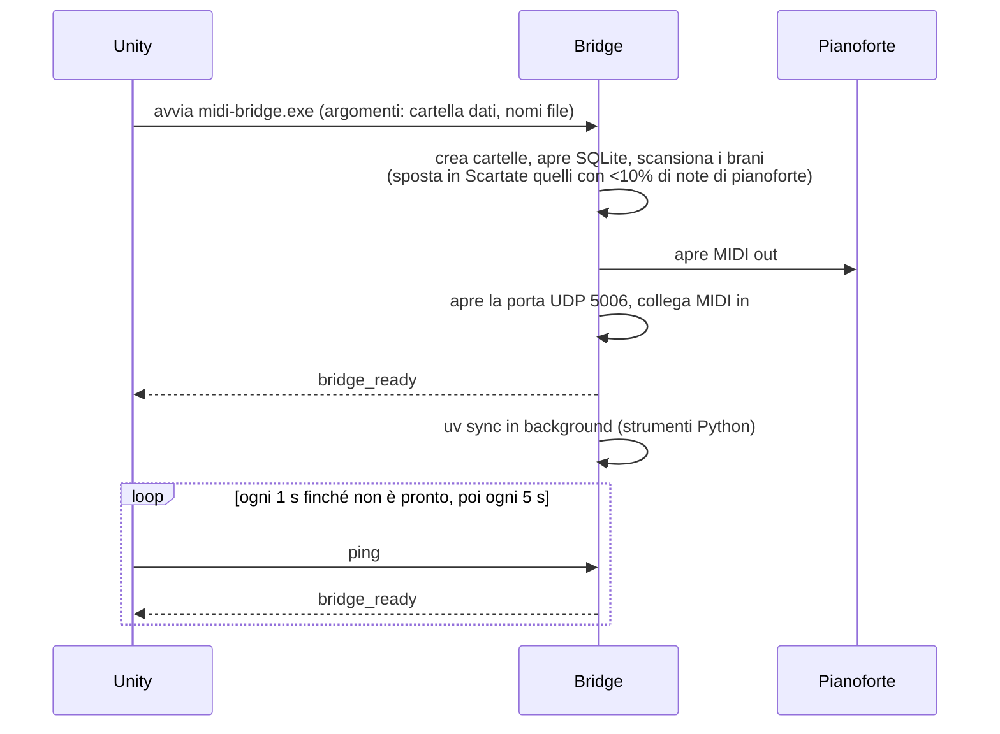

# Materiale per il capitolo "Progettazione e architettura"

Questo documento raccoglie tutto ciò che serve per scrivere il capitolo di tesi sulla progettazione
e sull'architettura del progetto: obiettivi, componenti, flussi, scelte progettuali con le loro
motivazioni, algoritmi, test e limiti. Ogni sezione indica i file sorgente da cui viene, così da
poter verificare o approfondire. In fondo ci sono una proposta di indice del capitolo, l'elenco delle
figure da preparare e un glossario.

Fonti principali nel repository:

| Documento | Contenuto |
|---|---|
| `README.md` | Installazione e avvio su Windows |
| `bridge/docs/architecture.md` | Architettura dettagliata del bridge (in inglese) |
| `bridge/docs/design-decisions.md` | Decisioni progettuali e differenze dall'implementazione originale |
| `bridge/README.md` | Comandi di sviluppo e test del bridge |
| `unity/Assets/Scripts/` | Codice dell'applicazione Unity |
| `reference/` | Bridge Python originale e simulatore Unity originale (non usati a run time) |

---

## 1. Il sistema in breve

**Obiettivo.** Un'applicazione di realtà mista per imparare il pianoforte. L'utente indossa un visore
Meta Quest 3 e suona una vera tastiera MIDI (un pianoforte digitale Yamaha). Grazie al passthrough vede
la stanza e il proprio strumento; sopra i tasti reali l'app sovrappone il feedback visivo: colonne che
salgono dai tasti premuti, guide verdi sulle note da suonare, sfere per lo staccato, menu, spartito e
report.

**Modalità d'uso** (enum `AppState` in `GameManager.cs`):

| Stato | Cosa fa l'utente |
|---|---|
| `Onboarding` | Calibra la posizione della tastiera virtuale su quella reale |
| `Menu` | Sceglie la modalità |
| `Tutorial` | Esegue sfide di tecnica su tre livelli di difficoltà, ognuna prima dimostrata |
| `Osservatore` | Ascolta e guarda un brano suonato dal pianoforte, con barra del tempo |
| `Seguimi` | Impara un brano a turni di due battute: prima la dimostrazione, poi suona lui, accordo per accordo, con lo spartito |
| `Fai tu` | Suona liberamente; l'esecuzione viene registrata con la mano usata e analizzata nel report |

**Hardware e software.**

| Elemento | Tecnologia |
|---|---|
| PC | Windows 11: esegue Unity, il bridge, gli strumenti Python e MuseScore |
| Visore | Meta Quest 3, collegato al PC Windows con Link (Play mode di Unity) |
| Strumento | Pianoforte digitale con MIDI in/out via USB: è sia la tastiera di input sia il generatore del suono |
| App | Unity 6000.3.11f1, URP 17.3, Meta XR SDK 201, OpenXR 1.16, AR Foundation 6.3 (ancore spaziali), Input System, uGUI + TextMeshPro |
| Bridge | Rust (crate `midi-bridge`): `midir` (porte MIDI), `midly` (file MIDI), `rusqlite` (libreria brani), `serde_json`, `clap`, `tracing` |
| Strumenti ausiliari | Python gestito con `uv`: `matplotlib`, `numpy`, `requests` |
| Incisione spartiti | MuseScore 4, richiamato da riga di comando |

**Punto chiave da sottolineare nella tesi:** l'app Unity non produce alcun suono (nel progetto non c'è
nessun `AudioSource`). Tutto il suono viene dal pianoforte reale: le note suonate dall'utente e anche
le dimostrazioni, che il bridge invia al pianoforte come messaggi MIDI. È una scelta di realismo: si
ascolta sempre lo strumento vero, con il suo timbro e la sua dinamica.

---

## 2. Requisiti

Requisiti ricavati dal codice e dalle scelte fatte. Possono diventare la sezione "Analisi dei
requisiti".

### Funzionali

| ID | Requisito | Dove è realizzato |
|---|---|---|
| RF1 | Allineare la tastiera virtuale a quella reale | `ManualAncohor.cs` (classe `ManualAnchor`) |
| RF2 | Mostrare in tempo reale le note suonate (colonne proporzionali alla velocity, colori per mano) | `PianoVisualizer.cs` |
| RF3 | Tutorial con sfide di tecnica (tocco, dinamica, articolazione, accenti, rubato) su tre livelli | `GameManager.cs`, `bridge/src/core/examples.rs` |
| RF4 | Riprodurre un brano sul pianoforte mostrandolo sopra i tasti, con salto a un punto qualsiasi | `BarraTempoOsservatore.cs`, `SliderTempo.cs`, `bridge/src/runtime/playback.rs` |
| RF5 | Insegnare un brano a turni: dimostrazione di 2 battute, poi l'utente le suona accordo per accordo | `GameManager.cs`, `bridge/src/core/follow.rs` |
| RF6 | Mostrare lo spartito della pagina che si sta suonando | `SpartitoSeguimi.cs`, `bridge/src/runtime/score.rs` |
| RF7 | Registrare l'esecuzione libera con l'informazione sulla mano (hand tracking) | `PianoVisualizer.cs` (`DeterminaMano`), `bridge/src/core/recorder.rs` |
| RF8 | Generare un report PDF della sessione (grafici, metriche, giudizio scritto, spartito, audio) e mostrarlo nel visore | `bridge/python/src/bridge_tools/report/` |
| RF9 | Gestire una libreria di brani e cercarne di nuovi online | `bridge/src/library.rs`, `bridge/python/src/bridge_tools/search/` |

### Non funzionali

| ID | Requisito | Come è soddisfatto |
|---|---|---|
| RNF1 | Bassa latenza tra tasto premuto e feedback visivo | Inoltro immediato via UDP su `127.0.0.1`; nessun lavoro lento sul thread del ciclo di eventi |
| RNF2 | Temporizzazione precisa della riproduzione | Thread dedicato, orologio monotono, attese in passi di al massimo 1 ms |
| RNF3 | Robustezza: un errore non deve bloccare l'app | Datagrammi malformati ignorati; report e spartiti in sottoprocessi; risposte di errore esplicite (`pages: 0`, `play_result` con errore) |
| RNF4 | Usabilità in VR con il raggio del controller | Componenti UI dedicati: scrollbar e slider senza soglia di trascinamento, feedback e "glow" all'hover |
| RNF5 | Testabilità senza visore | Logica del bridge senza I/O, suite end-to-end con Unity finto e porte MIDI virtuali |
| RNF6 | Compatibilità con l'implementazione precedente | Stesso protocollo, stessi file su disco, report identici pixel per pixel |
| RNF7 | Funzionare anche senza componenti opzionali | Senza MuseScore niente spartiti; senza `uv` niente report; il resto dell'app continua a funzionare |

---

## 3. Architettura generale

Il sistema è composto da tre processi sulla stessa macchina più il visore:

```
┌──────────────────────┐  comandi JSON · UDP :5006   ┌──────────────────┐  note · MIDI in    ┌─────────────────┐
│   App Unity          │ ──────────────────────────▶ │                  │ ◀───────────────── │                 │
│   (visore via Link)  │                             │   midi-bridge    │                    │  Pianoforte     │
│   stati, UI, visual. │ ◀────────────────────────── │   (Rust)         │ ─────────────────▶ │  digitale MIDI  │
└──────────────────────┘  eventi JSON · UDP :5005    └────────┬─────────┘  brani · MIDI out  └─────────────────┘
          ▲                                                   │
          │ legge PNG e JSON                                  │ `uv run`: JSON su stdin/stdout, file su disco
          │                                                   ▼
┌─────────┴────────────────────────────────┐      ┌───────────────────────────────────┐
│ Cartella dati                            │ ◀─── │ Strumenti Python                  │
│ libreria SQLite, .mid, spartiti, report  │      │ report-renderer · score-renderer  │
└──────────────────────────────────────────┘      │ song-search      (+ MuseScore 4)  │
                                                  └───────────────────────────────────┘
```

**Divisione delle responsabilità:**

- **Unity** possiede la macchina a stati dell'applicazione, l'interfaccia, il visualizzatore 3D, la
  calibrazione, l'hand tracking e il confronto tra l'accordo atteso e i tasti premuti in Seguimi.
- **Il bridge** possiede tutto ciò che riguarda il MIDI e il tempo: legge la tastiera, suona i brani sul
  pianoforte, registra le esecuzioni con i loro tempi, gestisce la libreria dei brani e fa partire i
  lavori lenti.
- **Gli strumenti Python** fanno lavori pesanti ma non in tempo reale: il report (grafici matplotlib,
  analisi, audio WAV), l'incisione dello spartito con MuseScore e la ricerca di brani online.

**Ciclo di vita.** Unity avvia il bridge all'inizio della scena e lo chiude alla fine
(`UdpReceiver.bridgeExecutable` e `bridgeArguments`). Il bridge annuncia `bridge_ready`. Finché non
lo riceve, Unity manda un ping ogni secondo; dopo, uno ogni 5 secondi, così si accorge se il bridge si
è fermato.

**Disposizione dei file su disco** (cartella dati; i nomi tra parentesi angolari sono opzioni da riga
di comando):

```
<data dir>/
├── <db file>                     SQLite: libreria dei brani (tabella midi_files)
├── <songs subdir>/               i file .mid (e Scartate/ per quelli senza pianoforte)
├── Spartiti/<brano>/             cache degli spartiti: brano.mid, battute.json, pagina_N.png, score.json
└── <sessions subdir>/Sessione_YYYYMMDD_HHMMSS/
                                  report PDF, pagina_N.png, Registrazione_Audio.wav,
                                  Esecuzione_Fai_Tu.mid, spartito_fai_tu_N.png
```

La comunicazione tramite file (PNG e JSON) tra bridge e Unity è voluta: le immagini delle pagine
sarebbero troppo grandi per un datagramma UDP, e i file restano disponibili per rivedere i report.

---

## 4. L'applicazione Unity

### 4.1 Script e responsabilità

| Script | Righe | Responsabilità |
|---|---|---|
| `GameManager.cs` | ~2700 | Macchina a stati (`AppState`), menu, tutorial (livelli e sfide), Seguimi (confronto accordo atteso / tasti premuti), viewer del report, palette dei colori |
| `SongListManager.cs` | ~1800 | Elenco dei brani, ricerca con tastiera virtuale, bottoni "+" e "Torna al Menu", gestione dei gruppi Osservatore e Seguimi |
| `PianoVisualizer.cs` | ~850 | Tastiera 3D di 88 tasti, colonne delle note, guide delle note attese, sfere dello staccato, mano usata |
| `UdpReceiver.cs` | ~660 | Avvio del bridge, socket UDP, parsing degli eventi e invio dei comandi |
| `ManualAncohor.cs` | ~470 | Calibrazione a 3 punti e ancora spaziale |
| `SpartitoSeguimi.cs` | ~380 | Bottone e pannello dello spartito, cambio pagina che segue il brano |
| `RaggioPuntatore.cs` | ~350 | Raggio di puntamento dei controller |
| `BarraTempoOsservatore.cs`, `SliderTempo.cs` | ~330 + 50 | Barra del tempo stile YouTube per saltare nel brano |
| `GlowBottone.cs`, `IndietroFeedback.cs`, `KeyFeedback.cs` | | Feedback visivo dei bottoni e dei tasti al passaggio del raggio |
| `ScrollbarVisuale.cs`, `BarraScorrimentoFluida.cs`, `ScrollDragReset.cs` | | Scorrimento adatto al raggio del controller (niente scatti, niente evidenziazioni "appese") |
| `BranoButtonUI.cs`, `BranoDinamicoUI.cs` | | Righe dei brani nell'elenco |

### 4.2 Calibrazione (realtà mista)

Il problema: la tastiera virtuale deve stare esattamente sopra quella reale. La soluzione
(`ManualAnchor.EseguiCalibrazione3Punti`):

1. Davanti all'utente compare una sfera guida, a 60 cm dallo sguardo e 20 cm più in basso.
2. Con un pinch, l'utente registra tre punti: estremo sinistro della tastiera, estremo destro e Do
   centrale. Ci sono due protezioni: un'attesa di 1,5 s tra due pinch, e almeno 15 cm di distanza
   dal punto precedente.
3. La direzione "destra" è il vettore tra i primi due punti proiettato sull'orizzontale. La
   direzione in avanti è il prodotto vettoriale con la verticale, e la profondità viene dal terzo
   punto.
4. La scala è la larghezza misurata divisa per quella teorica della tastiera, 1,1985 m su 88 tasti.
5. Il Canvas dei menu diventa figlio della tastiera, quindi segue posizione e scala.
6. Si aggiunge un `ARAnchor` (AR Foundation): la posizione resta stabile nello spazio reale.

### 4.3 Visualizzatore delle note

`PianoVisualizer`:

- **Colonne.** Ogni nota premuta fa salire una colonna sopra il suo tasto, con altezza proporzionale
  alla velocity. Le pressioni molto leggere hanno comunque un'altezza minima visibile.
- **Colori per mano.** Sinistra dal ciano al blu, destra dal giallo al rosso; il colore è più scuro con
  velocity più alta. In Osservatore e Seguimi la mano si deduce dalla nota (sotto il Do centrale =
  sinistra). In Fai tu e nel Tutorial viene dall'hand tracking: la mano il cui tracciamento è più vicino
  alla colonna (`DeterminaMano`).
- **Guide verdi** in Seguimi sulle note attese, con due verdi diversi per tasti bianchi e neri.
- **Sfere dello staccato.** Due note brevi in rapida successione, senza altri tasti premuti, ricevono
  una sfera, con lo stesso criterio usato dalle sfide del tutorial.
- **Mano usata.** In Fai tu e nel Tutorial, per ogni nota premuta, Unity invia al bridge la mano usata
  (`note_hand`).

### 4.4 Interazione in VR

Il raggio del controller trema e i componenti standard di uGUI sono pensati per il mouse. Per questo
ci sono componenti dedicati:

- scrollbar e slider che seguono il raggio dal primo movimento, senza soglia di trascinamento e senza
  scatti a "pagine", con un leggero smorzamento;
- feedback all'hover (ingrandimento, colore, alone "glow" con respiro);
- reset delle evidenziazioni durante lo scorrimento.

La palette è definita in `GameManager`: Tan `#d3b99f`, Dusty Rose `#c17767`, Inchiostro `#263452`,
con verifica del contrasto (per esempio 6,61:1 dell'Inchiostro sul Tan).

---

## 5. Il bridge (Rust)

### 5.1 Struttura: nucleo puro, ciclo di eventi, worker

È lo schema architetturale più importante da descrivere nella tesi.

```
  ricevitore UDP ──────┐
  callback tastiera ───┼──▶ canale mpsc ──▶ ciclo di eventi ──▶ core.handle(input) ──▶ effetti ──▶ esecutore
  thread worker ───────┘                                                                           │
        ▲                                                                                          │
        └─────────────────────────── avvia riproduzione / dimostrazione / report / spartito / ricerca ◀┘
```

- **Core** (`bridge/src/core/`): pura logica, senza socket, file né thread. È l'unico a possedere stato
  modificabile. Interfaccia: `core.handle(input, now, library) -> Vec<Effect>`.
- **Input**: `Command` (da Unity), `Note` (dalla tastiera), `PlaybackFinished`, `ReportFinished`,
  `SearchFinished` (dai worker).
- **Effect**: `Send(Event)`, `StartPlayback`/`StopPlayback`, `StartExample`/`StopExample`,
  `RenderReport`, `RenderScore`, `Search`.
- **Ciclo di eventi** (`runtime/mod.rs`): prende un input alla volta dal canale, chiama il core ed
  esegue gli effetti.
- **Worker** (`runtime/playback.rs`, `examples.rs`, `report.rs`, `score.rs`, `search.rs`): thread per i
  lavori lunghi. Comunicano con il core solo tramite il canale ("ho finito").

**Perché questa struttura** (da `design-decisions.md`):

| Decisione | Motivazione |
|---|---|
| Core senza I/O | Il comportamento si testa con semplici chiamate di funzione |
| Thread e un canale `mpsc` invece di un runtime asincrono | Un socket, una callback MIDI e pochi worker brevi non richiedono async |
| Un solo thread possiede lo stato | Nessun lock attorno allo stato |
| Rust per MIDI, protocollo, stato, libreria | Sono le parti in tempo reale e con stato |
| Python per report, WAV, analisi e scraping web | matplotlib, numpy e `requests` coprono già questi compiti |
| Strumenti Python come sottoprocessi (JSON su stdin/stdout, file in una cartella) | Nessuno stato condiviso; il ciclo di eventi non aspetta mai Python |
| `uv` per l'ambiente Python, sincronizzato all'avvio in background | Installazioni riproducibili; il primo report non aspetta l'installazione |
| Configurazione solo da riga di comando e variabili `MIDI_BRIDGE_*` | Unity avvia il bridge con una riga di comando fissa |
| JSON identico a `json.dumps` di Python | Unity riceve esattamente gli stessi byte della versione originale |
| Datagrammi malformati o sconosciuti ignorati | Robustezza, stesso comportamento dell'originale |

### 5.2 Stato tenuto dal bridge

| Stato | Perché sta nel bridge e non in Unity |
|---|---|
| Accordi di Seguimi e posizione corrente | `next_step` non porta la posizione |
| Note registrate (Fai tu e Seguimi) | Solo il bridge riceve la tastiera con tempi precisi |
| Brano in riproduzione | Le dimostrazioni del tutorial vengono rifiutate durante un brano |
| Ora dell'ultima richiesta di report | Anti-rimbalzo di 5 secondi |

Le note sono marcate con l'orologio monotono del bridge; si usano solo le differenze tra tempi.

### 5.3 Moduli

```
bridge/src/
├── main.rs, config.rs     avvio e opzioni
├── protocol.rs            Command / Event, parsing e codifica JSON
├── library.rs             libreria SQLite e scansione della cartella dei brani
├── midi/
│   ├── message.rs         messaggio MIDI grezzo
│   ├── timeline.rs        file .mid → lista unica di (ritardo, messaggio), battute
│   ├── analysis.rs        note di riferimento, accordi, riconoscimento del pianoforte, sicurezza
│   ├── hands.rs           quale mano suona ogni nota (per lo spartito)
│   ├── reduction.rs       riduzione per pianoforte a due mani da incidere
│   └── ports.rs           scelta e apertura delle porte MIDI
├── core/                  mod.rs (macchina a stati), follow.rs, recorder.rs, report.rs, examples.rs
└── runtime/               ciclo di eventi, servizi condivisi, UDP, worker, avvio di Python
bridge/python/src/bridge_tools/
├── report/                report-renderer: model, analysis, text, pages, audio, render, cli
├── score/                 score-renderer: musescore, smf, cli
└── search/                song-search: sources, http, cli
```

---

## 6. Protocollo di comunicazione Unity ↔ bridge

UDP su `127.0.0.1`: Unity → bridge sulla porta 5006, bridge → Unity sulla 5005. Ogni datagramma è un
oggetto JSON con un campo `action`. Motivi per UDP in locale: latenza minima, nessuna connessione da
gestire, compatibilità con l'implementazione originale. Su loopback la perdita di pacchetti è
trascurabile e i ping periodici coprono il riavvio del bridge.

**Comandi (Unity → bridge)**, da `bridge/src/protocol.rs`:

| Comando | Significato |
|---|---|
| `ping` | Il bridge è vivo? (risposta `bridge_ready`) |
| `list_songs`, `search_suggest`, `search_song` | Libreria: elenco, suggerimenti mentre si scrive, ricerca online |
| `play_song` (con `start` facoltativo) | Osservatore: suona un brano, eventualmente da un certo punto |
| `play_song_follow` (con `demo_bars`) | Seguimi a turni |
| `next_step` | Seguimi: l'utente ha completato l'accordo |
| `stop_song` | Ferma riproduzione e Seguimi |
| `play_example` (`sfida` 1-10), `stop_example` | Dimostrazioni del tutorial |
| `start_fai_tu`, `stop_fai_tu` | Inizio e fine della registrazione libera |
| `note_hand` | Mano (sinistra/destra) di una nota suonata in Fai tu |
| `get_report_status`, `generate_report` | Report |
| `get_score` (con `request`) | Spartito del brano scelto in Seguimi |

**Eventi (bridge → Unity):**

| Evento | Significato |
|---|---|
| `bridge_ready` | Il bridge è in ascolto |
| `{note, velocity, action: press/release}` | Nota premuta o rilasciata (dalla tastiera o da un brano) |
| `clear_scene` | Pulire il visualizzatore |
| `expect_notes` (con `time` nei turni) | Accordo da suonare in Seguimi |
| `song_progress` | Posizione e durata del brano, ogni 250 ms |
| `song_list`, `search_result`, `play_result` | Libreria e risultati, errori di riproduzione |
| `example_done` | Fine della dimostrazione del tutorial |
| `report_status`, `report_ready` | C'è qualcosa da riportare? Report pronto (cartella e numero di pagine) |
| `score_ready` | Spartito pronto (cartella e numero di pagine; 0 se non disponibile) |

Le richieste lente portano un numero (`request` in `get_score`) così Unity scarta le risposte che
arrivano tardi, relative a un brano precedente.

---

## 7. Flussi principali

I diagrammi sotto sono in Mermaid: GitHub li disegna, e si possono ridisegnare per la tesi.

### 7.1 Avvio



### 7.2 Osservatore

1. Unity invia `play_song` e il bridge assegna un nuovo id di riproduzione.
2. L'esecutore annulla il brano precedente e aspetta che finisca davvero. Questo corregge un difetto
   dell'originale, in cui due brani potevano suonare insieme.
3. Il thread di riproduzione legge il file in una timeline: tutte le tracce in una sola lista, con le
   variazioni di tempo applicate.
4. Tiene solo la parte di pianoforte: i canali con programma 0-7, mai il canale 10 della batteria.
5. Silenzia il pianoforte, poi invia ogni messaggio al pianoforte e ogni nota a Unity.
6. Invia `song_progress` ogni 250 ms. Unity lo usa per la barra del tempo; per saltare, rimanda
   `play_song` con `start`. Le note prima del punto di partenza vengono scartate, mentre pedali e
   cambi di programma vengono comunque inviati, così il suono è coerente.

### 7.3 Seguimi a turni con spartito

```mermaid
sequenceDiagram
    participant U as Unity
    participant B as Bridge
    participant P as Pianoforte
    U->>B: play_song_follow (demo_bars = 2)
    U->>B: get_score (request n)
    B->>B: note di riferimento → accordi (≤50 ms) → turni di 2 battute
    par spartito in background
        B->>B: riduzione a due mani → MuseScore → pagine PNG + score.json
        B-->>U: score_ready (request n, cartella, pagine)
    end
    loop per ogni turno con note
        B->>P: dimostrazione del turno (note anche a Unity, song_progress)
        B-->>U: clear_scene a fine turno
        loop per ogni accordo del turno
            B-->>U: expect_notes (note, time)
            U->>U: guide verdi; aspetta che l'utente prema tutte le note
            U->>B: next_step
        end
    end
    B-->>U: clear_scene (fine brano)
```

Dettagli da citare:

- **Accordi**: una nota fa parte dell'accordo corrente se inizia entro 50 ms dalla precedente.
- **Battute**: si calcolano dalle indicazioni di tempo e dai cambi di tempo del file
  (`Timeline::bar_starts`); senza indicazioni si assume 4/4.
- **Confronto in Unity**: un accordo è completato solo da tasti premuti dopo che è comparso
  (`notePremuteDopoAttesa`). Senza questa regola, con accordi ripetuti i tasti ancora tenuti
  completavano subito l'accordo successivo, a catena fino alla dimostrazione del turno dopo. Un
  doppio `note_on` dello stesso tasto (rimbalzo del sensore) non conta come nuova pressione.
- **Pagina dello spartito**: Unity mostra la pagina il cui inizio (`page_starts`) è stato superato,
  usando `time` di `expect_notes` mentre suona l'utente e `song_progress` durante la dimostrazione.
- **Durante la dimostrazione** le note dell'utente non vengono registrate e `next_step` viene
  ignorato.

### 7.4 Fai tu

1. `start_fai_tu`: il bridge inizia a registrare. Ogni nota completata è `{note, vel, start, end}`.
2. Per ogni pressione Unity calcola la mano con l'hand tracking e invia `note_hand`. Il bridge lo tiene
   come "suggerimento" per quel tasto e lo usa quando la nota si completa: il suggerimento può
   arrivare prima o dopo l'evento MIDI.
3. `generate_report` chiude la registrazione e avvia il report.

### 7.5 Tutorial

Tre livelli con sfide in sequenza (`bridge/src/core/examples.rs`). Ogni sfida viene prima dimostrata
dal pianoforte con uno script fisso (premi, aspetta, rilascia, aspetta), poi l'utente la esegue e
`GameManager` la valuta.

| Livello | Sfide |
|---|---|
| Facile (1-4) | Tocco leggero, crescendo, staccato, legato |
| Medio (5-7) | Eco dinamico, legato poi staccato, accento sul primo tempo |
| Difficile (8-10) | Ritardando, voce superiore più forte in bicordi, linea cantabile legata |

Riscegliendo un livello si riprende dalla sfida a cui si era arrivati; un livello completato resta
segnato per la sessione.

### 7.6 Report

```mermaid
sequenceDiagram
    participant U as Unity
    participant B as Bridge
    participant R as report-renderer (Python)
    U->>B: generate_report
    B->>B: anti-rimbalzo 5 s, un report alla volta
    B->>R: uv run report-renderer (sessione JSON su stdin)
    R->>R: PDF + pagina_N.png + WAV (+ spartito Fai tu con MuseScore)
    R-->>B: {"pages": N}
    B-->>U: report_ready (cartella, pagine; 0 se è fallito)
    U->>U: carica e mostra le pagine nel visore
```

---

## 8. Elaborazione musicale (algoritmi)

### 8.1 Lettura dei file MIDI e parte di pianoforte

- **Timeline**: tutte le tracce unite in una lista di messaggi con il ritardo in secondi, tempi
  applicati (`midi/timeline.rs`).
- **Parte di pianoforte** (`analysis::piano_part`): i canali il cui programma corrente è un pianoforte
  (0-7, o il predefinito), mai la batteria. Senza pianoforte si tiene tutto tranne la batteria; un
  file di sola batteria si tiene intero.
- **Filtro della libreria**: un brano con meno del 10% delle note su un pianoforte
  (`analysis::has_enough_piano`) viene spostato in `Scartate` e tolto dal database. Al primo avvio
  questo ha spostato 53 brani su 116. La stessa soglia vale per i brani scaricati.
- **Sicurezza per il visualizzatore**: un file con troppe note tenute insieme (oltre 60) viene
  rifiutato, perché bloccherebbe il visualizzatore.

### 8.2 Spartito: dal MIDI a una partitura leggibile

Problema: molti MIDI non sono partiture ma esecuzioni registrate. Le note non cadono sulla griglia e
lo staccato lascia buchi, e MuseScore li trascrive come pause, terzine e valori strani. Pipeline
(`runtime/score.rs` → `midi/reduction.rs` → `score/musescore.py`):

1. **Riduzione per pianoforte**: solo la parte di pianoforte, con tempo, indicazione di tempo e
   tonalità originali e gli stessi tick, così le battute dello spartito coincidono con quelle che
   conta il bridge. Lo stesso tasto su due canali vale come un solo tasto.
2. **Divisione tra le mani** (`midi/hands.rs`): due tracce, prima la mano destra e poi la sinistra.
   MuseScore legge due tracce di pianoforte consecutive come un unico pianoforte con doppio
   pentagramma (violino e basso). Algoritmo:
   - le note che iniziano insieme (entro 1/24 di tempo) formano un accordo;
   - ogni mano ha una posizione (all'inizio la destra sul Sol4 e la sinistra sul Mi3), che segue ciò
     che suona;
   - per ogni accordo si provano tutti i tagli possibili: note basse alla sinistra, alte alla destra;
   - costo di un taglio:
     - 0,5 per ogni semitono di distanza di una nota dalla sua mano;
     - 6 per semitono se una mano supera l'ottava;
     - 20 per ogni nota oltre la quinta in una mano;
     - 3 più 2 per semitono per una nota dalla parte "sbagliata" del Do centrale;
   - una mano ferma per 4 tempi torna a metà strada verso la posizione iniziale.

   Effetto: una melodia che scende di poco sotto il Do resta alla destra, un basso che sale di poco
   sopra resta alla sinistra, e una mano a riposo non "ruba" le note dell'altra. Il confronto con la
   semplice divisione al Do centrale è un buon esempio per la tesi (sezione 11).
3. **Note allungate (solo per lo spartito)**: ogni nota dura fino al prossimo attacco della stessa
   mano, se arriva entro 2 tempi; altrimenti si allunga al massimo di un tempo. Così uno staccato non
   diventa una fila di pause. Non si accorcia mai una nota.
4. **Opzioni di importazione di MuseScore**:

   | Opzione | Valore | Motivo |
   |---|---|---|
   | `MeasureCount2xLess` | `true` | Mantiene le battute del file (MuseScore altrimenti ne dimezza alcune) |
   | `RecognizePickupBar` | `false` | Nessuna battuta in levare: le battute restano quelle del bridge |
   | `QuantValue` | sedicesimi | Griglia non più fine del sedicesimo |
   | `VoiceCount` | 1 voce per rigo | Meno pause sovrapposte |
   | `Quintuplets`/`Septuplets`/`Nonuplets` | `false` | Le imprecisioni di tempo li creerebbero |
   | `ClefChanges` | `false` | Rigo sopra sempre mano destra in chiave di violino, rigo sotto sempre sinistra in chiave di basso |
   | `Swing` | spento (scartato) | Provato: sistema poche terzine ma rovinerebbe i ritmi puntati veri |

5. **Tempi delle pagine**: dalle posizioni delle battute che MuseScore esporta (`.mpos`) e dai tempi
   delle battute calcolati dal bridge si ottiene il secondo in cui inizia ogni pagina (`score.json`).
6. **Cache**: una cartella per brano. Si riusa se è più recente del brano ed è stata incisa dalla stessa
   riduzione; cambiando l'algoritmo, gli spartiti si rigenerano da soli.

**Risultati misurati** (numero di pause nello spartito, prima e dopo le modifiche):

| Brano | Prima | Dopo | Cambi di chiave prima → dopo |
|---|---|---|---|
| I'm Not in Love (10cc) | 2879 | 88 | 94 → 0 |
| Back to Black (Amy Winehouse) | 569 | 40 | 312 → 0 |
| Jingle Bells (Glenn Miller) | 1054 | 570 | 35 → 0 |

Jingle Bells resta il più denso perché è un arrangiamento per big band suonato in swing, con ritmi
puntati veri: è un limite, discusso nella sezione 11.

Su 64 MIDI della libreria, 57 dichiarano un'indicazione di tempo (3/4, 12/8, 2/4…), che lo spartito
rispetta. In molti file solo il 7-13% delle note cade sulla griglia dei sedicesimi: sono
esecuzioni, non partiture.

### 8.3 Spartito di "Fai tu"

Le note registrate vengono scritte in un MIDI a 120 BPM in 4/4 su due tracce, destra e sinistra, in
base alla mano rilevata dall'hand tracking (`score/smf.py`). Senza informazione sulla mano, la
divisione è al Do centrale. Il risultato viene inciso con le stesse opzioni di MuseScore.

---

## 9. Report e analisi dell'esecuzione

Generato da `report-renderer` (`bridge/python/src/bridge_tools/report/`). Moduli: `model.py`
(dati in ingresso), `analysis.py` (metriche), `text.py` (giudizi scritti), `pages.py` (una figura
matplotlib per pagina), `audio.py` (sintesi WAV), `render.py` (assemblaggio).

**Pagine:**

1. **Fai tu**: piano roll dell'esecuzione, colorato per mano e intensità, con legenda e giudizio
   scritto (articolazione, dinamica, bilanciamento tra le mani, fraseggio).
2. **Spartito di Fai tu**, se MuseScore è disponibile.
3. **Per ogni brano di Seguimi**:
   - "cromagramma": le note del brano sopra quelle dell'utente, sulla stessa scala temporale;
   - pagina di analisi: radar dell'"impronta espressiva" del brano e dell'utente, valutazione scritta
     e guida.

**Metriche** (`analysis.py`):

- **Radar a 5 assi, da 0 a 1**: peso (intensità), varietà dinamica, legato, rubato, bilanciamento tra
  le mani.
- **Articolazione**: ogni nota è classificata legato, staccato o intermedia, in base a quanto è tenuta
  rispetto alla distanza dall'attacco successivo.
- **Allineamento**: le note dell'utente sono abbinate a quelle del brano per altezza, in ordine, su
  tempi relativi; le note "mancate" si contano solo nel tratto effettivamente suonato.

Il report viene anche mostrato nel visore come immagini (`pagina_N.png`), in un viewer con scroll e
zoom adatti al raggio del controller.

---

## 10. Test e validazione

| Livello | Cosa verifica |
|---|---|
| Test unitari Rust | Moduli del bridge, compreso il core senza I/O con una libreria in memoria (132 test) |
| Test differenziali | Lettura MIDI in Rust confrontata con `mido`; analisi del report confrontata con le funzioni originali, su dati generati |
| Test golden | Pagine del report identiche pixel per pixel a quelle dell'originale; stesso testo del PDF e stesso audio |
| Test end-to-end | Stessi scenari eseguiti contro il bridge Rust e contro l'originale Python, con Unity finto (UDP), porte MIDI virtuali e copie locali dei siti web |
| Test dello spartito | Scrittura MIDI a due mani, tempi delle pagine (Python); divisione delle mani e note allungate (Rust) |
| Test "live" | I siti reali (freemidi.org, bitmidi.com) corrispondono ancora allo scraper |

Gli scenari end-to-end sono stati scritti prima contro l'implementazione originale: questo garantisce
che la riscrittura abbia lo stesso comportamento osservabile. Le sole differenze sono quelle volute
(sezione 11.1).

Il sistema gira su Windows. Sul PC Windows del progetto girano i test unitari Rust, i test
differenziali, i test golden e i test dello spartito. La suite end-to-end invece non gira su Windows:
crea tastiera e pianoforte virtuali con le porte MIDI virtuali di CoreMIDI, che esistono solo su
macOS (vedi `bridge/README.md`). Su Windows il comportamento end-to-end è stato verificato provando
il sistema dal vivo con il Quest 3 e il pianoforte.

---

## 11. Evoluzione del progetto e scelte discusse

Materiale per la parte "discussione" del capitolo: problemi incontrati, alternative valutate e
decisioni prese.

### 11.1 Da bridge Python a bridge Rust

La prima versione del bridge era uno script Python (`reference/midi_bridge.py`). È stata riscritta in
Rust mantenendo identico il protocollo verso Unity, e Python è rimasto per report e ricerca. Difetti
dell'originale corretti nella riscrittura (da `design-decisions.md`):

| | Originale | Ora |
|---|---|---|
| D1 | Dopo "stop e play" il brano precedente continuava a suonare insieme al nuovo in circa un caso su quattro | Ogni riproduzione ha il suo token di annullamento; la precedente finisce prima che parta la successiva |
| D2 | File mancante: nessuna risposta, oppure si seguiva il brano precedente | `play_result` con errore, stato invariato |
| D3 | Il report si generava sul thread dei comandi: ping e comandi aspettavano | Sottoprocesso, un report alla volta |
| D4 | Un report fallito non mandava nulla e Unity aspettava 120 s | `report_ready` con `pages: 0` |
| D5 | Porta 5006 occupata: il processo restava acceso senza ascoltare | Esce con un messaggio di errore |
| D6 | Scelta delle porte MIDI fragile | Esclusione delle porte virtuali; `--midi-in` e `--midi-out` per nome |
| D7 | Note registrate con l'ora di sistema | Orologio monotono |

### 11.2 Seguimi: da accordo per accordo a turni con dimostrazione

Prima l'utente seguiva il brano accordo per accordo senza ascoltarlo. Ora il brano è diviso in turni di
due battute: il pianoforte suona il turno (imitazione, il "ti faccio vedere, poi fai tu" di un
insegnante), poi l'utente lo ripete. I turni senza note si saltano.

### 11.3 Spartito

- **Posizione nel visore**: lo spartito sopra le colonne copriva il feedback e costringeva a guardare
  in alto. Ora è sotto il bottone "Visualizza spartito", largo quanto il bottone, a lato della
  tastiera. Il bottone è alla stessa distanza dal "+" di quella tra "Torna al Menu" e il "+".
- **Leggibilità**: vedi 8.2. Divisione delle mani in tre tentativi: (a) lasciata a MuseScore, che
  metteva il basso nel rigo superiore; (b) divisione fissa al Do centrale, corretta ma rigida; (c)
  algoritmo a costi con posizione delle mani. Il primo tentativo dell'algoritmo era troppo libero: una
  mano ferma perdeva la sua melodia. È stato corretto rafforzando il costo di attraversare il Do
  centrale e riducendo quello di spostamento.
- **Cambi di chiave disattivati**: si sacrifica un po' di eleganza (qualche taglio addizionale) in
  cambio di una regola semplice per chi impara: sopra la destra, sotto la sinistra.

### 11.4 Altre scelte da motivare

- **Il suono viene solo dal pianoforte reale** (sezione 1).
- **Il confronto dell'accordo in Unity e non nel bridge**: Unity conosce già i tasti premuti e
  aggiorna le guide visive nello stesso frame; il bridge resta la fonte dei tempi per il report.
- **Unity possiede la macchina a stati**: vincolo del progetto (`design-decisions.md`, sezione 1);
  il bridge non aggiunge tipi di evento che Unity non conosce.
- **Filtro solo-pianoforte**: un'app per imparare il pianoforte non deve chiedere di suonare la parte
  di chitarra o batteria; i brani senza abbastanza pianoforte vengono esclusi dalla libreria.

---

## 12. Limiti e sviluppi futuri

- Lo spartito ricavato da esecuzioni registrate resta approssimato (swing, rubato, arrangiamenti
  orchestrali). Si potrebbe stimare la pulsazione o riconoscere lo swing brano per brano.
- La divisione delle mani nello spartito è euristica e non conosce la diteggiatura.
- I file senza indicazione di tempo vengono trattati come 4/4.
- In Osservatore e Seguimi la mano si deduce dall'altezza della nota, non dall'hand tracking.
- Il sistema gira con il visore collegato al PC (Link): il bridge e MuseScore stanno sul PC.
- Le valutazioni del report sono basate su regole; mancano studi con utenti per tarare le soglie.
- La suite end-to-end automatica non gira su Windows, perché usa le porte MIDI virtuali di macOS. Per
  automatizzarla anche qui servirebbe un driver di porte MIDI virtuali per Windows (per esempio
  loopMIDI) e un adattamento del banco di prova.

---

## 13. Proposta di indice del capitolo

1. Introduzione al capitolo: obiettivi del sistema e vincoli (sezioni 1-2)
2. Architettura generale: componenti, deployment, ciclo di vita (sezione 3)
3. Protocollo di comunicazione (sezione 6)
4. L'applicazione in realtà mista: stati, calibrazione, visualizzazione, interazione (sezione 4)
5. Il bridge: nucleo puro, ciclo di eventi, worker; motivazioni (sezione 5)
6. Le modalità di apprendimento e i loro flussi (sezione 7)
7. Elaborazione musicale: parte di pianoforte, accordi e turni, spartito e divisione delle mani
   (sezione 8)
8. Valutazione dell'esecuzione: il report (sezione 9)
9. Verifica e test (sezione 10)
10. Scelte progettuali, evoluzione e limiti (sezioni 11-12)

## 14. Figure e tabelle da preparare

| Figura | Fonte |
|---|---|
| Diagramma dei componenti e del deployment | Sezione 3 |
| Macchina a stati di Unity (`Onboarding → Menu → Tutorial / Osservatore / Seguimi / Fai tu`) | `GameManager.cs`, `AppState` |
| Struttura del bridge: core, canale, worker | Sezione 5.1 |
| Diagrammi di sequenza: avvio, Seguimi a turni, report | Sezione 7 |
| Calibrazione a 3 punti (schema geometrico) | Sezione 4.2 |
| Screenshot nel visore: colonne, guide verdi, sfere dello staccato, spartito, report | Registrazione dal visore |
| Prima/dopo dello spartito (stesso brano, vecchia e nuova pipeline) | `Desktop/Tesi Nora Limni/Nora/Spartiti/<brano>/pagina_N.png` rigenerate |
| Tabella delle pause prima/dopo | Sezione 8.2 |
| Pagine del report (piano roll, cromagramma, radar) | `Desktop/Tesi Nora Limni/Nora/Sessioni/Sessione_*/pagina_N.png` |
| Tabella delle differenze D1-D7 | Sezione 11.1 |
| Piramide dei test | Sezione 10 |

## 15. Glossario

| Termine | Significato |
|---|---|
| Bridge | Il programma Rust che collega Unity, la tastiera MIDI e gli strumenti Python |
| Core | La parte del bridge con tutta la logica e lo stato, senza I/O |
| Effetto | Azione richiesta dal core (inviare un messaggio, avviare un worker) ed eseguita dal ciclo di eventi |
| Worker | Thread del bridge per un lavoro lungo (riproduzione, report, spartito, ricerca) |
| Datagramma | Un messaggio UDP; qui un oggetto JSON |
| Velocity | Intensità con cui è premuto un tasto MIDI (0-127, normalizzata 0-1) |
| Note di riferimento | Le note della parte di pianoforte di un brano, con inizio e durata |
| Turno | Tratto di 2 battute di Seguimi: prima dimostrato, poi suonato dall'utente |
| Riduzione per pianoforte | Il brano ridotto alla parte di pianoforte su due tracce (mani), da incidere |
| Incisione | Trasformare il MIDI in partitura grafica (qui con MuseScore) |
| Passthrough | La visione della stanza reale attraverso le telecamere del visore |
| Ancora spaziale | Riferimento che tiene un oggetto virtuale fermo nello spazio reale (`ARAnchor`) |
| Hand tracking | Tracciamento delle mani del visore, usato per sapere quale mano ha suonato |
